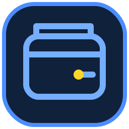

<h1 align="center"><b>About Me</b></h1>

Hi! I'm <strong>MD FAHIM MIA</strong>, a Computer Science and Technology (CST) student at Rangpur Ideal Institute of Technology (RIIT), Rangpur, Bangladesh.

I'm passionate about programming, problem-solving, algorithms, and emerging technologies. My primary focus is <strong>Competitive Programming (CP)</strong>, where I'm continuously developing my logical thinking, algorithmic knowledge, and problem-solving abilities.

I'm currently building my programming foundation with C, C++, and Python while exploring Data Structures and Algorithms (DSA). I enjoy learning new concepts, solving challenging problems, and improving my coding skills through consistent practice.

Alongside Competitive Programming, I'm also interested in <strong>Artificial Intelligence and Machine Learning (AI/ML)</strong>. I'm following a separate learning roadmap to develop knowledge of mathematics, statistics, Python, and machine learning.

My long-term ambition is to become a skilled Software Engineer, excel in competitive programming, and build a career in the global technology industry.

<strong>My Philosophy:</strong> Learn continuously, think logically, solve efficiently, and never stop improving.

# 💻 Tech Stack:
                                       

<!-- ========================================================= -->
<!-- 03. PROBLEM PRACTICE PLATFORMS                             -->

<h2 align="center">💻 Problem Practice Platforms</h2>

<table width="760" border="1" cellpadding="10" cellspacing="0" align="center">
  <thead>
    <tr>
      <th width="380" align="left">Platform</th>
      <th width="380" align="center">Profile Link</th>
    </tr>
  </thead>
  <tbody>
    <tr>
      <td width="380">
        
        &nbsp;&nbsp;<strong>LeetCode</strong>
      </td>
      <td width="380" align="center">
        <a href="https://leetcode.com/u/faheemcodexpy/">View Profile</a>
      </td>
    </tr>
    <tr>
      <td width="380">
        
        &nbsp;&nbsp;<strong>Codeforces</strong>
      </td>
      <td width="380" align="center">
        <a href="https://codeforces.com/profile/faheemcodexpy">View Profile</a>
      </td>
    </tr>
    <tr>
      <td width="380">
        
        &nbsp;&nbsp;<strong>CodeChef</strong>
      </td>
      <td width="380" align="center">
        <a href="https://www.codechef.com/users/faheemcodexpy">View Profile</a>
      </td>
    </tr>
  </tbody>
</table>

<!-- ========================================================= -->
<!-- 04. FIND ME ONLINE                                         -->

<h2 align="center">🌐 Find Me Online</h2>

<table width="760" border="1" cellpadding="9" cellspacing="0" align="center">
  <thead>
    <tr>
      <th width="380" align="left">Where</th>
      <th width="380" align="center">Link</th>
    </tr>
  </thead>
  <tbody>
    <tr>
      <td width="380">
        
      </td>
      <td width="380" align="center">
        <a href="https://www.linkedin.com/mdfahim1miae1">Visit Profile</a>
      </td>
    </tr>
    <tr>
      <td width="380">
        
        &nbsp;&nbsp;<strong>Portfolio</strong>
      </td>
      <td width="380" align="center">
        <a href="https://www.fahimportfolio.com">Visit Website</a>
      </td>
    </tr>
    <tr>
      <td width="380">
        
      </td>
      <td width="380" align="center">
        <a href="https://www.facebook.com/mdfahim1mia">Visit Profile</a>
      </td>
    </tr>
    <tr>
      <td width="380">
        
      </td>
      <td width="380" align="center">
        <a href="https://www.kaggle.com/">Visit Profile</a>
      </td>
    </tr>
    <tr>
      <td width="380">
        
      </td>
      <td width="380" align="center">
        <a href="https://www.tiktok.com/@fahim_ahmed_codex?_r=1&amp;_t=ZS-9BOzzfkbv7J">Visit Profile</a>
      </td>
    </tr>
    <tr>
      <td width="380">
        
      </td>
      <td width="380" align="center">
        <a href="https://www.instagram.com/">Visit Profile</a>
      </td>
    </tr>
    <tr>
      <td width="380">
        
      </td>
      <td width="380" align="center">
        <a href="https://www.twitter.com/">Visit Profile</a>
      </td>
    </tr>
    <tr>
      <td width="380">
        
        &nbsp;&nbsp;<strong>Email</strong>
      </td>
      <td width="380" align="center">
        <a href="mailto:mdferdushlebu@gmail.com">Send Email</a>
      </td>
    </tr>
  </tbody>
</table>

<!-- ========================================================= -->
<!-- 05. LEETCODE PROFILE VIEW                                  -->
<h2 align="center">  LeetCode Profile View</h2>
<h3 align="center">What I Practice?</h3>

I practice core Data Structures &amp; Algorithms topics, including Arrays &amp; Strings, Hashing, Two Pointers, Sliding Window, Sorting &amp; Searching, and Binary Search.

I also work on Linked Lists, Stacks &amp; Queues, Trees &amp; Graphs, Recursion &amp; Backtracking, Greedy Algorithms, and Dynamic Programming.

<h3 align="center">LeetCode Profile Statistics</h3>

<!-- ========================================================= -->
<!-- 06. CODEFORCES PROFILE VIEW                                -->
<h2 align="center">  Codeforces Profile View</h2>
<h3 align="center">What I Practice?</h3>

I practice a broad range of Competitive Programming topics on Codeforces, including Implementation, Mathematics, Greedy, Brute Force, Sorting, Binary Search, Two Pointers, Prefix Sums, Number Theory, and Bit Manipulation.

I also work on Graphs, Trees, and Dynamic Programming to strengthen my algorithmic thinking and problem-solving abilities. Through regular contest participation and upsolving, I aim to improve my coding efficiency, accuracy, and ability to approach unfamiliar problems logically.

<h3 align="center">Codeforces Activity Statistics</h3>

<!-- ========================================================= -->
<!-- 07. MY PROJECTS                                            -->
<h2 align="center">My Projects &nbsp;&nbsp; </h2> 

A few things I've built while learning and exploring.

<table width="100%" border="1" cellpadding="12" cellspacing="8">
  <tbody>
    <tr>
      <td width="430" valign="top">
        <h3>01 · Smart Expense Tracker &nbsp;&nbsp;&nbsp;   </h3>
        
<strong>Category:</strong> C++ Project

        
A smart expense management application that helps users track daily expenses, organize spending categories, manage budgets, and generate expense summaries.

        
<strong>Technologies:</strong> C++ · OOP · STL · File Handling · Data Structures

        
<strong>Difficulty:</strong> Beginner–Intermediate

        
      </td>
      <td width="430" valign="top">
        <h3>02 · Space Dodger Game &nbsp;&nbsp;&nbsp;  </h3>
        
<strong>Category:</strong> Python Project

        
An entertaining 2D space game where players control a spaceship, dodge incoming obstacles, collect points, and try to beat their highest score.

        
<strong>Technologies:</strong> Python · Pygame

        
<strong>Difficulty:</strong> Beginner

        
      </td>
    </tr>
    <tr>
      <td width="430" valign="top">
        <h3>03 · Movie Review Sentiment Analyzer &nbsp;&nbsp;&nbsp;  </h3>
        
<strong>Category:</strong> AI &amp; Machine Learning

        
A beginner-friendly machine learning application that analyzes movie reviews and predicts whether the sentiment is Positive or Negative.

        
<strong>Technologies:</strong> Python · Pandas · NumPy · Scikit-learn · NLP

        
<strong>Difficulty:</strong> Beginner

        
      </td>
      <td width="430" valign="top">
        <h3>04 · Personal Study Planner &nbsp;&nbsp;&nbsp;  </h3>
        
<strong>Category:</strong> Web Development

        
A simple study management application that allows users to organize daily tasks, set deadlines, track progress, and manage completed activities.

        
<strong>Technologies:</strong> HTML · CSS · JavaScript · Local Storage

        
<strong>Difficulty:</strong> Beginner

        
      </td>
    </tr>
  </tbody>
</table>

<!-- ========================================================= -->
<!-- 08. MY LEARNING ROADMAP                                    -->
<h2 align="center">🚀 My Learning Roadmap</h2>

<table width="100%" border="1" cellpadding="10" cellspacing="0">
  <tbody>
    <tr>
      <th width="430" align="center">PYTHON → AI / ML ENGINEER</th>
      <th width="430" align="center">C++ → COMPETITIVE PROGRAMMER</th>
    </tr>
    <tr>
      <td width="430" valign="top">
        <h3>Python Core</h3>
        <ul>
          <li>Syntax &amp; OOP</li>
          <li>Functions</li>
          <li>Modules and Python fundamentals, etc.</li>
        </ul>
        <h3>Data &amp; Math</h3>
        <ul>
          <li>NumPy &amp; Pandas</li>
          <li>Statistics</li>
          <li>Data Analysis, etc.</li>
        </ul>
        <h3>AI / ML</h3>
        <ul>
          <li>Machine Learning</li>
          <li>Deep Learning</li>
          <li>PyTorch &amp; TensorFlow, etc.</li>
        </ul>
        
<strong>ML Workflow:</strong> Data → Models → Model Evaluation, etc.

        
<strong>🎯 AI / ML ENGINEER</strong> Generative AI · Real-World Projects · Deployment, etc.

      </td>
      <td width="430" valign="top">
        <h3>C++ Core</h3>
        <ul>
          <li>OOP &amp; C++ STL</li>
          <li>Complexity</li>
          <li>Memory Management, etc.</li>
        </ul>
        <h3>Algorithms</h3>
        <ul>
          <li>Sorting &amp; Searching</li>
          <li>Greedy Algorithms</li>
          <li>Graph Algorithms, etc.</li>
        </ul>
        <h3>Advanced DSA</h3>
        <ul>
          <li>Trees &amp; Graphs</li>
          <li>Dynamic Programming</li>
          <li>Backtracking, etc.</li>
        </ul>
        
<strong>CP Problem Solving:</strong> Logical Thinking · Efficiency · Contest Skills, etc.

        
<strong>🏆 COMPETITIVE PROGRAMMER</strong> Codeforces · Contests · Upsolving, etc.

      </td>
    </tr>
  </tbody>
</table>

<!-- ========================================================= -->
<!-- 09. SKILLS & TOOLS                                         -->
<h2 align="center">Skills &amp; Tools</h2>
<!-- Optional: add your exact Skills & Tools infographic URL here and uncomment. -->
<!--  -->

<table width="100%" border="1" cellpadding="12" cellspacing="6">
  <tbody>
    <tr>
      <td width="286" align="center"> <strong>C</strong></td>
      <td width="286" align="center"> <strong>C++</strong></td>
      <td width="286" align="center"> <strong>Python</strong></td>
    </tr>
    <tr>
      <td width="286" align="center"> <strong>Java</strong></td>
      <td width="286" align="center"> <strong>SQL</strong></td>
      <td width="286" align="center"> <strong>PHP</strong></td>
    </tr>
    <tr>
      <td width="286" align="center"> <strong>HTML</strong></td>
      <td width="286" align="center"> <strong>CSS</strong></td>
      <td width="286" align="center"> <strong>JavaScript</strong></td>
    </tr>
    <tr>
      <td width="286" align="center"> <strong>Linux</strong></td>
      <td width="286" align="center"> <strong>Git</strong></td>
      <td width="286" align="center"> <strong>PyTorch</strong></td>
    </tr>
  </tbody>
</table>

<!-- ========================================================= -->
<!-- 10. THANKS FOR VISITING MY PROFILE                         -->

<!-- ========================================================= -->
<!-- 11. RESERVED SECTION                                      -->
<!-- You specified 11 total sections, but have provided details for 10.
     Add the 11th section title, text, and requirements here when ready.
     No invented section has been added. -->
